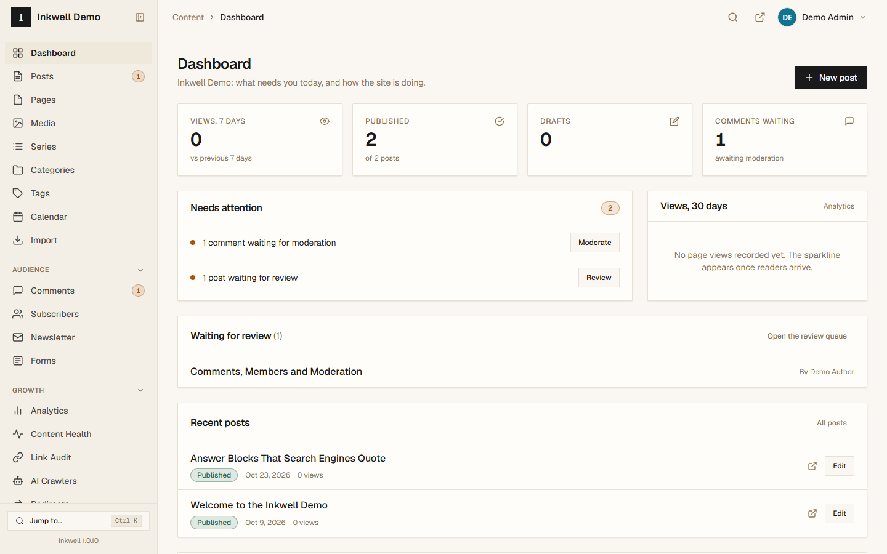
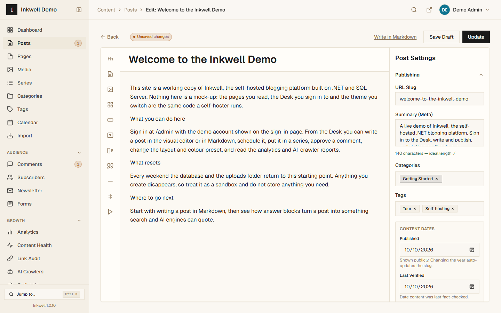
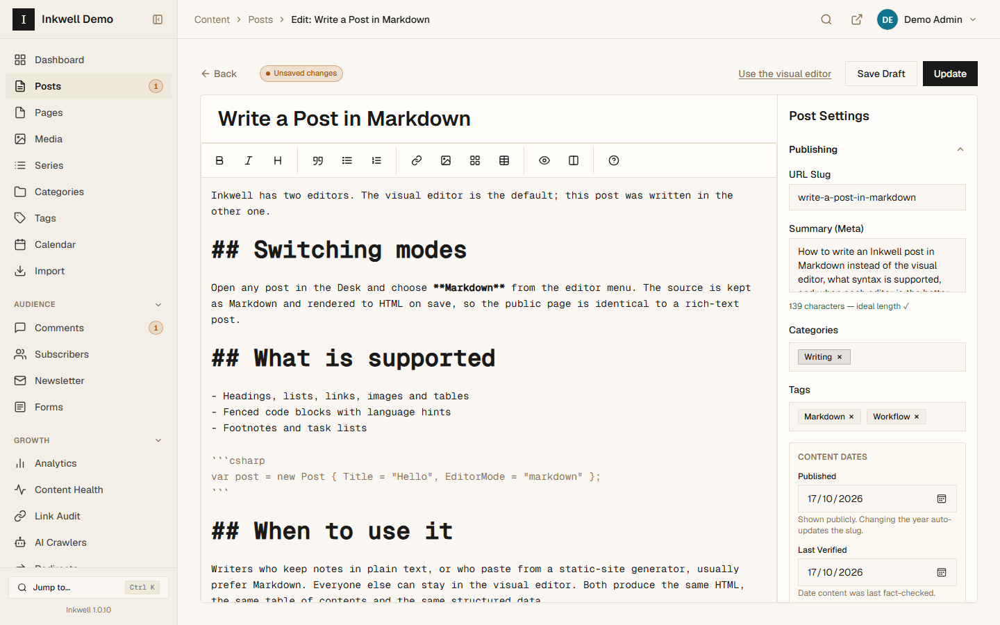
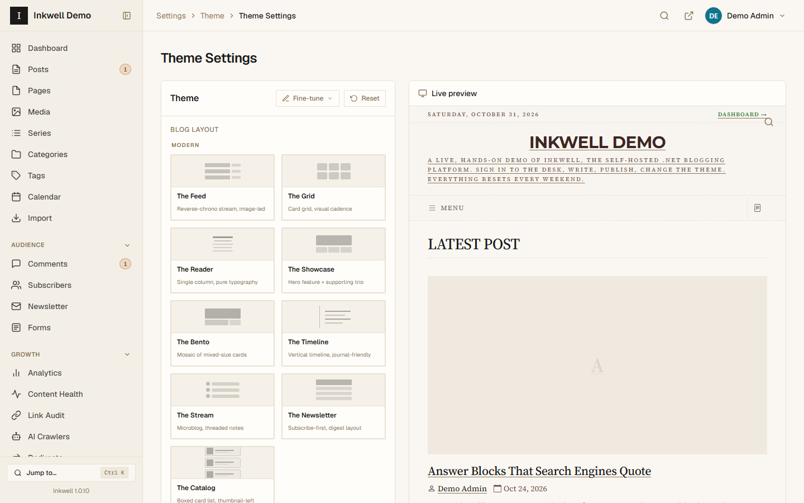
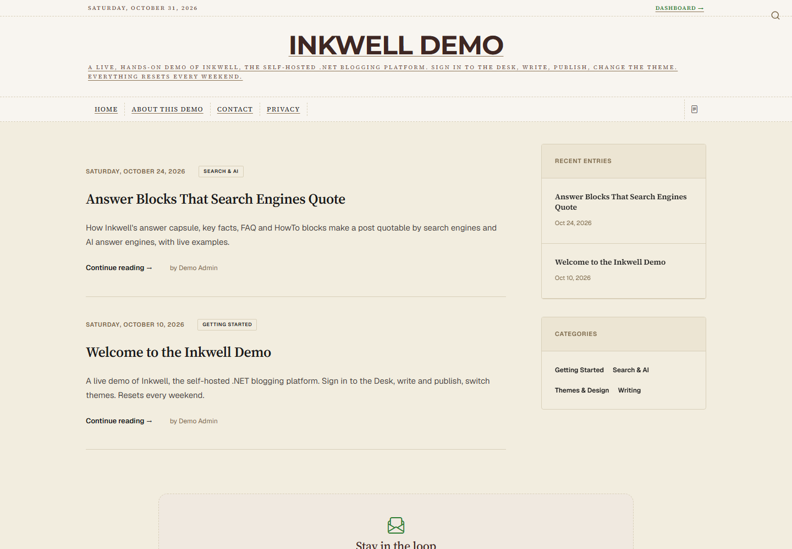
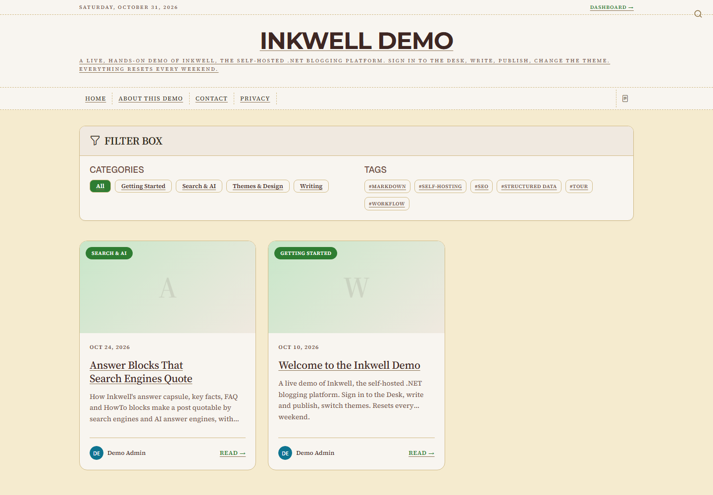
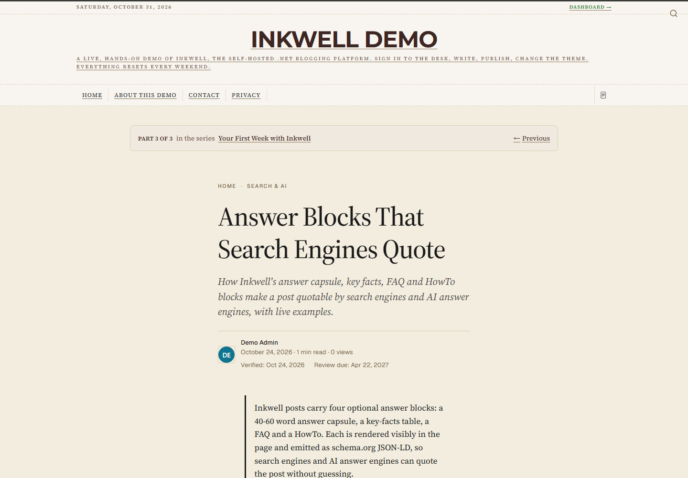

# Inkwell

**A free, open-source, self-hosted blogging platform built on .NET 10.**
Multi-tenant by default, themeable, and crafted for writers and teams who care about
typography, content ownership, and a calm editorial experience.

🌐 https://www.useinkwell.app · 📄 MIT licensed · 🔒 No telemetry, no cloud account

## Screenshots

| The Desk dashboard | Visual editor |
|---|---|
|  |  |

| Markdown editor | Theme settings with live preview |
|---|---|
|  |  |

| Journal layout, Linen preset | Grid layout, Folio preset |
|---|---|
|  |  |



Captured from the demo content in `DemoDeployment/` on Inkwell 1.0.10.

## Why Inkwell

- **Self-hosted & private** — your content, your server, your data. You are the sole data controller.
- **Zero-ORM performance** — Dapper with raw SQL. No Entity Framework, no lazy-load surprises.
- **Multi-tenant** — one binary serves many blogs. Cloud mode isolates tenants by URL slug; self-hosted mode runs a single-owner install.
- **Themeable** — 16 Inkwell color presets × 20 layouts (Magazine, Feed, Catalog, Verdict, Grid, Minimal, Neutral, Classic, Modern, and more) with live CSS variable customization from the admin panel.
- **Analytics built-in** — page view tracking, UTM attribution, geo-location (country/region via ip-api.com), traffic source classification, and Chart.js dashboards. No third-party tracker required.
- **Audit Trail** — immutable, admin-only log of every write action across the platform. Filterable and Excel-exportable.
- **Error Monitor** — 4xx/5xx errors grouped by signature with counts and first/last-seen, an admin dashboard, and optional email alerts on new server errors.
- **IP Firewall** — hostile addresses (exploit scanners, brute-force sign-ins) are scored and blocked automatically, with an admin screen to review, allowlist, and tune. Search and AI crawlers are protected from being blocked.
- **SEO & AI-search ready** — structured data, author E-E-A-T pages, per-tenant `llms.txt`/`llms-full.txt`, **IndexNow** instant indexing (Bing, Yandex, Seznam, Naver), and an **AI-crawler report** showing which answer engines actually read your posts.
- **Your database** — SQL Server 2019+ or SQL Server LocalDB. Schema auto-applies on startup via `MigrationService`; no manual migration step needed.

---

## Quick Start

```bash
git clone https://github.com/marutisoftwaresolutions/inkwell
cd inkwell
dotnet run
```
Full docs: https://www.useinkwell.app/docs

### Deploy with Docker

```bash
cp .env.example .env    # set DOMAIN and MSSQL_SA_PASSWORD
docker compose up -d
```

Starts the app, a SQL Server container, and Caddy for automatic HTTPS on the domain in `.env`. On
first boot a one-off `db-init` container creates the `blog` database and applies
`DBScripts/init.sql`; the app starts once that succeeds, then the setup wizard runs at your domain. `docker-compose.yml`, `Dockerfile`, `docker/Caddyfile` and `.env.example` are at the
repo root — read the comments in `docker-compose.yml` for the local-evaluation option (no domain, no
TLS, the app's port published directly instead of through Caddy).

A single container without the bundled database also works — see the `docker run` example at the
top of `Dockerfile` — pointed at your own SQL Server via `ConnectionStrings__DefaultConnection`.
Create that database and run `DBScripts/init.sql` against it first.

---

## Features

- **Quill WYSIWYG Editor** — rich-text post editing with image upload, code blocks, dividers, and custom button blots. A post can also be written in Markdown (see Markdown authoring).
- **Role-Based Access Control** — Admin, Editor, and Author roles with 10 granular permission claims (`posts.edit`, `posts.publish`, `posts.delete`, `pages.manage`, `comments.manage`, `categories.manage`, `tags.manage`, `media.manage`, `settings.manage`, `themes.manage`). Disabling or deleting a user ends their Desk sessions and API tokens at once; every sign-in is re-checked against the account. Self-registration only creates the first (admin) account; after that, people join by invitation.
- **Theme & Layout System** — Inkwell color presets, 20 layout variants (including the **Verdict** scored-roundup format for "Top N Best… Software" buyer's guides and the **Catalog** single-column boxed card list for SaaS-style company blogs), and a `CustomThemeSettings` key/value store for CSS variable overrides.
- **Analytics Dashboard** — page views with UTM params, referrer, visit source, country/region. A view is counted when the page's own self-hosted script reports back with a signed token (no cookies), so clients that never run JavaScript — scrapers and request floods — are not counted, the same basis Google Analytics uses; readers with JavaScript disabled are not counted either. Known bots, scripts and fetchers are also filtered by user-agent, and recording is buffered and written in batches. A post's "most read" count (used by the popular-posts lists and the 404 page) is counted from the same beacon, so the two figures agree. The whole report is read in one stored-procedure call and cached for five minutes; past days come from a daily summary that an hourly job keeps current, so the screen stays quick on a site with millions of recorded views and keeps its history after raw views are pruned. Settings → Keep page-view details (default 0, keep everything) prunes the per-view detail — address hash, browser, exact time — after 31–3650 days, and only from days already summarised. Chart.js visualizations.
- **AI-crawler analytics** — Admin → AI Crawlers reports which AI answer engines and search crawlers actually fetch the site, how often, and which pages they read. Recorded to its own table, so human visitor numbers are unaffected. Every crawler Inkwell can name is listed **including those with zero visits** — an engine that has never read the site is a finding, not an omission — with the operator's published purpose, a daily trend, the most-crawled pages, and the requests that carried a query string (so `/?page=500` and `/?p=123` are told apart from `/`). A user-agent is self-declared, so each visit from Googlebot, Bingbot, Applebot, GPTBot, OAI-SearchBot, ChatGPT-User, PerplexityBot or Perplexity-User is checked against the IP list or reverse-DNS name its operator publishes; the report shows verified, failed and unchecked visits, and leaves failed ones (someone else using the name) out of its totals, trend and top pages. Operators that publish no method (Meta, Anthropic, Amazon, Common Crawl, …) stay unchecked. The check never allows or denies a request. The report is read in one stored-procedure call and cached for five minutes; past days come from a daily summary that an hourly job keeps current, so only today's visits are read directly.
- **Audit Trail** — every admin write action logged with user, IP, and timestamp. Read-only from the UI; exportable as Excel via ClosedXML.
- **Error Monitor** — a global exception handler and status-code logger record 4xx/5xx errors into an `ErrorLogs` table, grouped by signature (status + normalized path + exception type) so similar/repeat errors collapse into one counted row. Admin → Error Monitor lists groups with counts, first/last-seen, and filters; optional SMTP email alerts notify configured recipients the first time a new server error appears.
- **IP Firewall (automatic blocking)** — every failing request is weighed by a threat scorer: exploit probes (`.php`/`wp-admin`/`.env`/path traversal/SQL-injection payloads) score 5, rejected sign-ins 3, ordinary 404s 1. When an address crosses the threshold (default 10 points in 10 minutes) it is blocked automatically — 24 hours on the first offense, a week on the second, permanently on the third — and refused with a bare 403 before any other work happens. Admin → Security shows active rules, the live watchlist of addresses building a score, and per-rule denied-request counts; addresses can be blocked or allowlisted by hand (also one-click from Admin → Error Monitor, which now records each signature's last client IP). Rules live in `IpFirewallRules` so blocks survive a restart; enforcement reads an in-memory snapshot, so an attack costs no per-request database work. Search and AI crawlers (Googlebot, Bingbot, GPTBot, ClaudeBot, …) are never blocked for 404s — unless the address has been proven not to be that crawler (outside its published IP list and with foreign reverse DNS; Google, Bing and Apple) — loopback and private ranges are never blocked at all, and the firewall fails open if the database is unreachable.
- **Redirects & 404 manager** — Admin → Redirects lists, creates, edits and removes redirect rules with 301, 302 or **410 Gone**, including the rules post renames and imports write automatically. The 404 log becomes a worklist ranked by evidence that a reader hit it — another page links to it, or it closely matches a real published slug — with one-click "301 to the suggested post" or "410 to retire it"; scanner noise is collapsed out of the way. Loops, chains and rules pointing at a retired URL are refused. Admin-only; every change audited.
- **Webhooks** — Admin → Webhooks sends a signed JSON `POST` to any public address when a post is published, updated or unpublished (including a scheduled post reaching its time), a page is published, a reader submits a comment, or a visitor sends a contact form. Deliveries are queued and sent by the scheduler, never on the publish request, and retried after 1 minute, 5 minutes, 30 minutes and 2 hours before being marked failed; each endpoint has a 30-day delivery log with the response code, **Redeliver**, and **Send test**. Requests carry `X-Inkwell-Event`, a stable `X-Inkwell-Delivery` id and an HMAC-SHA256 `X-Inkwell-Signature` over the timestamp and body; the signing secret is stored Data-Protection-encrypted and never shown again. Addresses on the server itself or a private network are refused, including host names that resolve to one. Payloads never include commenter email addresses or IPs. Admin-only and audited.
- **REST API** — `/api/v1` for scripts and headless front ends. Anyone can read published posts (`GET /posts`, `/posts/{slug}`), pages (`/pages/{slug}`), categories and tags, in an explicit public shape (what a reader sees on the page, never review notes, schedules or internal fields). Sign in with `POST /auth/login` (email, password and, with two-factor on, `code`) for a 15-minute bearer token, then create, update, publish and delete posts (HTML as `content` or Markdown as `markdown`, plus `customFields`), moderate comments and edit your profile. Tokens carry your Desk permissions: a Contributor drafts and edits only their own posts, publishing needs the publish permission, a published post can be changed or deleted only by someone who may publish, publishing runs the same structured-data check as the Desk (and is refused with the problems listed), saves are kept in revision history, and every write is in the audit trail. Errors come back as JSON. An expired token is not counted against the caller by the IP firewall. Disabling an account stops its token at once. The API stays off until `Jwt:Key` is set to a real secret.
- **Navigation menus** — Admin → Menus builds the header and footer menus from pages, categories, tags, series, the home feed (footer) or custom links, ordered and nested one level, with an optional new-tab setting. Items point at content by id, so renaming a slug never breaks a menu, and content that is deleted or unpublished drops out on its own. Every navbar and footer variant renders them. Until a header menu is saved the header shows the pages marked “Show in navigation” exactly as before, and a site with no footer menu shows no extra footer row. Custom links accept a site path or an http(s) address only.
- **Markdown authoring** — write a post or a page in Markdown instead of the visual editor: choose **Write in Markdown** on a new one, or switch an existing one (its HTML becomes the Markdown source, and the switch is refused if that would change how it looks). The editor is self-hosted (EasyMDE, no CDN) with a toolbar, keyboard shortcuts and a preview rendered by the server, so it matches what readers see. CommonMark plus tables, strikethrough, task lists and footnotes; HTML is allowed. The HTML is rendered from the Markdown on every save, so pages, feeds, search, `llms.txt` and exports work exactly as before. Revisions keep the Markdown. The posts API accepts `markdown` as well as `content`. The Ghost importer can keep Markdown posts as Markdown.
- **Two-factor sign-in** — any user can add a 6-digit code from an authenticator app (Google Authenticator, Microsoft Authenticator, 1Password, Bitwarden, Authy) to their sign-in under Profile → Two-factor sign-in: scan a QR code, confirm one code, and save ten single-use recovery codes. After the password, the Desk asks for the code; the API (`POST /api/v1/auth/login`) takes it as `code`. Each code works once, wrong codes count toward the IP firewall's sign-in limits, and every change is audited. Optional by default; an Admin can require it for chosen roles in Settings → Notifications & housekeeping, and people in those roles are asked to set it up before they reach the Desk. An Admin can turn it off for a user who lost their phone (Users → Reset 2FA). After restoring a backup onto a new server, app codes cannot be checked until the user sets two-factor up again, because the encryption keys stay behind; recovery codes still work.
- **Custom fields** — define your own fields under Settings → Custom fields (text, number, date, web address or yes/no; for posts, pages or both) and fill them in from a “Custom fields” panel in the editors. Fields marked “Show to readers” appear as a “Details” list on the page and, on posts, as `additionalProperty` in the structured data; the others stay internal. Values are checked by type and shown again at the field when one is wrong. Renaming a field keeps its values, removing one never deletes them, and changing its type flags values that no longer fit instead of clearing them. WordPress exports carry them as native custom fields. The API returns them as typed values on posts and pages (fields kept from readers go only to someone who could edit that post or page) and accepts them on post create and update, checked the same way; a field it does not know or a value of the wrong type is refused by name, never dropped.
- **Gallery block** — several images in a grid of two, three or four columns, from every editor: the post and page builders (with alt text, captions, order and columns in the block settings), `/gal` in the rich-text editor, and a toolbar button in the Markdown editor. Images are picked from the media library in the order chosen. Each image links to its full-size file, so galleries work without JavaScript; readers with it get a self-hosted lightbox (keyboard and screen-reader friendly), loaded only on pages that have a gallery.
- **Export to WordPress and Ghost** — Admin → Export downloads the site's content as a WordPress WXR 1.2 file or a Ghost import ZIP (JSON plus `content/images`), after showing what carries over for your actual content. WordPress gets posts, pages, categories, tags, authors, comments and images (downloaded by WordPress during import), plus search and social fields for Yoast SEO and Rank Math. Ghost gets posts, pages, tags (categories become tags) and bundled images; it cannot import comments. Roundups, FAQs, how-to steps, key facts, answer capsules and series are written into the body as ordinary HTML. Email addresses are opt-in. Admin-only and audited; files are streamed and deleted when the download finishes (`Exports:Path`, default `App_Data/exports`).
- **Push straight to WordPress or Ghost** — from the same screen, send the selection to a running WordPress or Ghost site through its API instead of downloading a file. Enter the site's address and a WordPress application password or a Ghost Admin API key; Inkwell checks them first and sends nothing if they do not work. Choose what happens to a post or page whose address already exists there: **leave it** (the default, so running the push again sends only what is missing), **replace it**, or **add a second copy**. The push runs in the background, a batch every minute, with a progress page listing each post's outcome; images are uploaded once each and their links rewritten. A failed item is retried twice, a "slow down" answer pauses the push until the site allows more, and it resumes from the first unsent item after any interruption. The password or key is held in the server's memory only while the push runs — never saved, logged or audited — so after a restart you enter it again to resume. A push does not send comments, authors (everything is credited to the account whose password or key you use) or, on WordPress, Yoast/Rank Math and custom fields, which its API does not accept; the file export keeps those. Public `https://` sites only. Admin-only, audited, not available in cloud mode.
- **Cookie consent** — on by default: the public site shows a self-hosted banner, and Google Analytics (when a Measurement ID is set) loads only after the reader chooses **Accept analytics cookies**; **Reject** is an equal button, the choice is remembered for 180 days, and **Cookie settings** at the foot of every page changes it. With no Measurement ID the banner is a notice that only essential cookies are used. Turn it off in Settings → Search & analytics to restore Analytics on every page. The built-in Analytics sets no cookies either way.
- **Backup and restore** — Admin → Backups makes a whole-site backup in the background: one ZIP with posts, pages, taxonomy, series, users and roles, settings, theme, menus, redirects, snippets, webhooks, firewall rules, comments, subscribers, newsletters, revisions, the audit trail and every uploaded file (page-view analytics optional). Backups are stored outside the web root (`Backups:Path`, default `App_Data/backups`), the newest `Backups:Keep` (default 10) are kept, and each can be downloaded. To restore, copy the ZIP into a fresh install's backups folder and choose **Restore from a backup** on the first-run screen; the database is restored in one transaction with all keys preserved, so users sign in with their old passwords. The Data Protection key ring is **not** in a backup, so the Search Console connection and webhook signing secrets must be entered again after a restore. A backup contains password hashes and subscriber emails: store it like a password. Admin-only, audited, and not available in cloud mode.
- **Editorial review** — authors without the publish permission submit posts for review instead of publishing: the post shows as *In review*, an Editor or Admin approves it (it goes live, or at its scheduled time) or sends it back with a note (*Needs changes*), and the author sees the note in the editor. The Posts list filters by both states and the dashboard shows the review queue to editors and returned posts to authors. Readers never see a post in review or one that needs changes, on any page, feed, sitemap, search or `llms.txt`. Every change is audited.
- **Answer-engine readiness score** — a 0–100 score per post for how ready it is to be *quoted*, not just ranked: answer capsule, Key Facts, FAQ, meta description, section headings, internal links, freshness, depth and feature image, each weighted and each with concrete advice. Shown in the editor sidebar and as a column, tile and filter in Content Health. Advisory only — it never blocks a publish, and nothing unobservable is scored.
- **Accessibility checks** — the post and page editors list what a screen-reader or keyboard user would trip over in the saved body: images without alt text (an empty alt for a decorative image is fine), alt text that is just a file name, skipped heading levels or a second Heading 1, links that say nothing on their own ("click here", "read more", or no text), tables without a header row, and paragraphs over 150 words. Each comes with what to do about it. Content Health has an Accessibility view that runs the same checks across published posts. Advisory only: nothing blocks a publish.
- **Publisher identity (knowledge graph)** — Admin → Settings carries publisher type (Organization/Person), legal name, founder, founding date, authority profiles (Wikipedia, Wikidata, company registers), a contact email, contact page and contact type, and an identity statement. Profiles join the social links in `sameAs`; the facts become `legalName`/`founder`/`foundingDate` on the publisher node, and the contact details a `contactPoint`; the statement is published verbatim in `llms.txt`. Optional throughout — unsupplied or unparseable values are omitted rather than guessed at, and non-absolute URLs are dropped.
- **Import dry-run** — preview a WordPress or Ghost import before it writes: creates, slug clashes and renames, overwrites, skips with reasons, image count, and a report of internal links that would not resolve. Read-only by construction — the preview path cannot write.
- **Answer capsules** — an optional short direct answer shown above the article and emitted as schema.org `abstract`, giving search and AI engines a passage written to be quoted. Authored in the editor with a 40-60 word target; the structured-data linter flags capsules that are too short or too long.
- **Internal-link suggester** — while editing a post, the sidebar proposes internal links in both directions (link out to, and should link here), shows outbound/inbound counts against the two-in / two-out minimum, and flags orphans. Ranked suggestions with a stated reason; never auto-applied.
- **Link Audit** — Admin → Link Audit scans published posts and pages for internal links that are broken, point at a URL retired with 410, or pass through one or more redirect hops, separating dead ends (which cost the reader) from hops (which cost link equity). Read-only; Editor and Admin roles.
- **Pre-publish structured-data linter** — before a post goes live its FAQ, Key Facts, How-To and roundup blocks are validated, and a post whose structured data would not validate is saved as a draft rather than published. Malformed JSON is caught rather than silently rendering as an empty block, and the policy rules are enforced in code: every roundup entry links the vendor real site as an absolute URL, `ctaUrl` stays the internal review path, scores sit on the 0-10 scale, and a product the author flags as made by the site's publisher (`"firstParty": true` on the roundup entry) may be featured but is never scored, ranked first or badged as the pick; its entry shows one neutral line saying who makes it. Advisory issues surface as warnings and never block publishing.
- **Content Health** — Admin → Content Health lists published posts needing maintenance: overdue or upcoming content reviews (`LastVerifiedAt` / `NextReviewAt`), posts never verified, missing Key Facts or FAQ blocks, meta descriptions that are missing or will truncate in search results, and titles carrying a year that has already passed. Tiles act as filters and every row links to the editor. Read-only; Editor and Admin roles.
- **Content calendar** — Admin → Calendar shows a month at a glance: posts published that month, posts scheduled, and drafts (or posts in review) that carry a date, each on its day in the site's time zone and labelled by status. Move between months or jump back to this one; every entry opens its editor, where dates are changed. Phones get the same month as a list of days. Read-only.
- **Right-to-left sites** — set the site language to Arabic, Hebrew, Persian, Urdu or another right-to-left language and every public layout and preset mirrors: navigation, indents, borders and lists start from the right. The direction follows the language; there is nothing else to set. The Desk stays left to right. Self-hosted fonts cover Latin scripts; Arabic and Hebrew text uses the reader's system fonts.
- **Contact forms** — Admin → Forms builds forms from name, email, short and long text, choice list, checkbox and consent fields (up to 20), with your own button text and thank-you message; a new form starts as a ready-made contact form. Add one to any page with the **Form** block in the page editor. Readers get a plain, accessible form in your theme that works without JavaScript and, with it, sends in place with errors shown at each field. Every submission passes the same spam checks as comments (hidden honeypot, signed timing token, link and markup limits, repeat and per-address limits) and spam is discarded silently and reported to the IP firewall. Submissions are listed per form with search and paging, can be deleted singly or in bulk and downloaded as CSV, can be emailed to an address you choose (replying answers the visitor), and are sent to webhooks as `form.submitted`. Each form sets how long submissions are kept (default 365 days, deleted nightly). The sender's address is stored only as a keyed hash. Admin-only and audited; included in backups.
- **Subscriber list** — a public subscribe form with double opt-in (confirm and unsubscribe links by email) and an admin subscriber list.
- **Newsletter** — Admin → Newsletter: write an issue (subject, preview text, an introduction in Markdown and up to six of your posts as cards), preview it, send a test to yourself, then send it to every confirmed subscriber. Sending runs in the background in batches (`Newsletter:BatchSize` per minute, default 50) through your SMTP server, with retries and a send log you can follow or stop. Every copy has the subscriber's own unsubscribe link and one-click unsubscribe headers (RFC 8058); opening an unsubscribe link only asks, so mail scanners cannot unsubscribe anyone. No tracking pixels or rewritten links. Admin-only, audited, single-site installs only (not in cloud mode). Set up SPF, DKIM and DMARC for the sending domain so newsletters reach inboxes.
- **Redirects Manager** — source/destination redirect rules with per-rule hit-count tracking. Each rule carries a status code: **301** (moved, the default), **302** (temporary), or **410 Gone** to retire a URL deliberately — the 410 serves a dedicated page and de-indexes far faster than leaving the URL as a 404.
- **Members** — member directory with label-based segmentation.
- **Media Library** — secure upload organized by year/month (anti-forgery protected, with the busy bar and the server's reason on a rejected file), folder tabs and search that live in the URL, a delete dialog that names the posts and pages still embedding a file, paginated API for in-editor browsing, alt text and captions per image (**Add alt** / **Details** on each image, copied into galleries when they are placed), and automatic WebP conversion of raster uploads (JPEG/PNG/GIF → WebP, with dimensions captured) via SixLabors.ImageSharp; SVG and existing WebP pass through unchanged. **Responsive images:** every JPEG, PNG and WebP upload also gets 480, 800 and 1200 px WebP copies (only those narrower than the original), made at upload and, for images already on disk, by a background job; pages add `srcset`, `sizes`, `width` and `height` as they are shown, so phones download a fraction of the bytes and the page does not shift as images load. The stored posts are unchanged.
- **Series & collections** — group posts into an ordered reading sequence (multi-part guides). Managed in Admin → Series (create, add posts, reorder); each series gets a public `/series/{slug}` page and a `/series` directory, member posts show a "Part N of M · Previous / Next" banner, and series emit `CollectionPage`/`ItemList`/`BreadcrumbList` schema and appear in the sitemap.
- **Comments with built-in spam protection** — readers can comment and reply on posts without an account; comments are moderated from Admin → Comments (approve, return to pending, delete, delete as spam, singly or in bulk, with search and Pending/Approved/All tabs). Every public submission passes a spam gate before it is stored: a hidden honeypot field, a signed form-timing token (the form must have been fetched, and not submitted within seconds of rendering), rejection of HTML/BBCode/Markdown links and of more than two links, repeat detection (an identical body posted again within 30 days, under any name), and a per-address rate limit. Discarded spam is never stored and gets the same "awaiting moderation" reply a real submission would, so senders cannot tune against it; each discard is reported to the IP Firewall so a persistent source blocks itself. Signed-in staff are never filtered. Works with zero configuration and alongside optional reCAPTCHA.
- **Search Console integration** — connect your own Google Search Console property under Admin → Settings with a service-account key (no platform-owned OAuth app, no shared credentials). A nightly job pulls clicks, impressions, CTR and position per page and query into the platform (first run backfills up to 16 months; later runs re-pull the last three days because Google revises them) and shows them where decisions are made: a **Search performance** panel in the post editor with the post's 28-day numbers, their change against the previous 28 days, and the queries that produced them; **Striking distance**, **Losing impressions** and **Low CTR for rank** filters and a Search column in Admin → Content Health; and a 28-day tile on the dashboard. The key file is stored encrypted and never shown, logged or exported. Every screen explains an empty state (not connected, no sync yet, never appeared in search) rather than showing a blank.
- **Table of contents and reading progress** — long posts get an "On this page" list built from their headings, with stable anchor ids, plus a reading-progress bar; the 404 page offers search seeded from the requested path and the most-read posts.
- **Dark colour scheme** — Settings → Colour scheme: follow each reader's device (default), or force light or dark, for the public site and the Desk. Dark uses the Ink preset's palette; presets that are already dark keep their own.
- **Site search** — a search icon in every header variant, and a results page at `/search?q=…` with the count, the query, and a refine box. Results pages are `noindex,follow`.
- **Bulk actions on posts** — select rows in the Posts list to publish, move to draft, add a tag, or delete them together, with per-post permission checks and audit entries.
- **Comment moderation with Spam and Reply** — delete a comment as spam and have its address reported to the IP Firewall, or reply from the Desk as yourself; both audited.
- **Draft preview links** — from the editor, create a signed link that shows a post as last saved to a reviewer without an account. Valid seven days, nothing stored, `noindex` and `no-store`, comments closed, not counted as a view. Works for published posts too, showing the saved state.
- **Conditional GET on post pages** — every public post page carries a weak `ETag` and `Last-Modified` derived from the post, its approved comments, the theme, the site settings and the deployed build, with `Cache-Control: no-cache`. A browser or crawler that revalidates with `If-None-Match` or `If-Modified-Since` gets a `304` instead of a full render and transfer when nothing changed. Signed-in staff and previews are never served from a validator.
- **Cacheable home and post pages** — an anonymous request for `/` or for a post sets no cookie and is not marked `no-store`, so a CDN edge rule can cache them. The newsletter form fetches its anti-forgery token only when a reader presses Subscribe (without JavaScript, a short confirm page carries it). The comment and reply forms fetch theirs when a reader reaches the comments and send in place, with the outcome announced next to the form; without JavaScript a comment lands on a short page that keeps what the reader typed and sends it on the next press.
- **Revision history** — every saved change to a post or page with different content writes a revision (title, body, meta, structured blocks, plus the slug and status at the time). The editor sidebar lists them; Compare shows a line-level diff against the current body with restore in one click. A restore first records the current content as a revision, so it is itself reversible, and never changes the slug or publish state. The number kept per item is a setting (default 25).
- **UTC everywhere, displayed in your zone** — publish, schedule and visibility checks all run in UTC, so a post is never live at its URL yet missing from the homepage, feed and sitemap because the host's clock differs from the stamp's. Admin → Settings → Display → **Date and time** sets the site's country, time zone, date format and clock: every date readers and staff see follows them, and a typed schedule time is read in that zone.
- **Dates in your country's format** — pick a country and its IANA time zones and date formats are offered (249 countries, 419 zones, 548 country locales, generated from the IANA Time Zone Database and Unicode CLDR into database tables by a dated script), or use ISO 8601 (2026-10-05) everywhere; force a 24-hour or 12-hour clock if you like. Every layout, post card, footer and Desk screen shows dates in that format and zone, with a live preview in Settings. Calendar dates ("last verified", "next review") never shift between zones, sites on Arabic, Thai or Persian locales show the Gregorian year, and structured data, feeds and sitemaps keep their standard UTC formats. `tools/RefDataGenerator` rebuilds the catalogs when tzdata or CLDR publish.
- **Self-service password reset** — "Forgot your password?" on the sign-in page emails a single-use link that expires in 30 minutes. Only the hash of the token is stored, the response is identical whether or not the address has an account, requests per account are capped at three an hour, and both the request and the reset are audited. When SMTP is not configured the page says so instead of failing silently.
- **The Desk** — the admin is one shell for every screen: a grouped, collapsible sidebar (Content, Audience, Growth, System, Settings) with count badges for comments awaiting moderation and posts waiting for review, an icon rail for small laptops, a breadcrumb and page title with the primary action beside it, an account menu, and a **Ctrl/Cmd K** command palette that jumps to any screen or action and searches posts. The dashboard is a working surface: linked tiles with the 7-day change in page views, a "Needs attention" list (moderation, reviews, overdue refreshes, scheduled posts, failed jobs, server errors, firewall blocks) that is honest when empty, a 30-day sparkline, the review queue and recent posts. Every screen shares one component vocabulary (buttons, inputs, cards, tables, pills, tabs, overflow menus) compiled into one stylesheet at build time, renders in both colour schemes and works at phone width; destructive actions and publishing go through one accessible dialog.
- **Version in the Desk** — the running version appears under the sign-out button and on the dashboard, so an operator can confirm a deploy; public pages never show it.
- **Scheduled jobs** — a built-in, in-process scheduler runs housekeeping (nightly AI-crawler visit retention, hourly optional page-view retention, expired reset-token pruning, Search Console sync, pruning of generated social-card images older than 30 days) hourly daily-summary roll-ups for Analytics and AI Crawlers, and, every minute, webhook delivery and any queued backup, with no external cron or task scheduler. Each job's last run, outcome and report are recorded in a `Jobs` table and shown on Admin → Dashboard; a failing job never affects request handling, and a job missed during a restart runs on the first tick back.
- **Reading time** — every post layout shows "N min read", computed from the post's text at a standard 238 words per minute by one shared helper so no two screens disagree.
- **Deploy-hygiene check** — on startup the platform compares `wwwroot` against its mapped routes and reports any file that would silently shadow a dynamic endpoint (a leftover `llms.txt`, `robots.txt`, ownership key) on Admin → Dashboard; the four AI/SEO files that were once static are removed automatically.
- **Browse by category, tag, or search** — the public feed carries filter chips for every category and tag that has published content, alongside full-text search. Each chip opens that category's or tag's own `/category/{slug}` or `/tag/{slug}` archive, and the active chip clears the filter. Filter combinations are not offered as separate pages: an older `?category=…&tags=…` or multi-tag URL answers 301 with the single archive it narrows to, and `robots.txt` asks every crawler to skip filter and search parameters, so crawlers cannot walk an endless tree of combinations. Unknown slugs return 404, and archives with no published posts are never linked. Listings answer only the parameters they use: a page number past the last page returns 404, and any other query parameter is dropped with a 301 to the clean URL, keeping paging, search, filters, `utm_*` campaign tags and ad click ids (`gclid`, `fbclid`, `msclkid` and similar), so crawlers cannot fetch endless variants of the same page.
- **WordPress & Ghost importer** — migrate an existing blog from Admin → Import: upload a WordPress WXR (`.xml`) or Ghost JSON (`.json`/`.zip`) export, preview and select what to import (posts, pages, categories/tags, images, comments), then run a batched, resumable import with a live progress bar, per-item exception log, and a downloadable report. Referenced images are downloaded and converted to WebP, content HTML is sanitized, and old permalinks become redirects to preserve SEO. Ghost bodies fall back to a best-effort Lexical/Mobiledoc conversion when no rendered HTML is present, and images bundled in a Ghost `.zip` are read straight from the archive. An import can be undone. Step-by-step export instructions for both platforms are shown in the importer. Admin-only.
- **SEO & AI-search ready** — per-page canonical URLs, Open Graph / Twitter Cards, and OG image generation; JSON-LD structured data (`Organization`, `WebSite` + `SearchAction`, `BlogPosting`, `BreadcrumbList`, `FAQPage`, `CollectionPage`, roundup `ItemList`/`Review`, author `Person`); length-aware ` | Brand` page titles (the brand suffix is dropped rather than letting the title overflow the ~60-character SERP budget, so the differentiator survives instead of the boilerplate), `noindex` on thin/search/paginated pages, and **filter-URL canonicalization** — a single-value `/?tags=x` or `/?category=y` 301s to the clean `/tag/{slug}` / `/category/{slug}` archive so filter permutations never compete as separate URLs, while multi-value combinations stay `noindex,follow`; **tag archives become indexable once they hold enough posts** (thin ones stay `noindex` and are kept out of the sitemap, so a sitemap never advertises a `noindex` URL); **author E-E-A-T pages** at `/author/{slug}`; **"At a glance" key-facts** and **How-To step** blocks (with `HowTo` schema) for AI-extractable content; per-tenant **content language** driving `lang`/`hreflang`/`og:locale`/`inLanguage`; dynamic `sitemap.xml` (posts, categories, tags, series, pages, authors) with per-post image entries and automatic sitemap-index chunking for large sites, plus an RSS feed; content freshness dates (`LastVerifiedAt` / `NextReviewAt`); AEO signals — a **per-tenant `llms.txt`** + expanded **`llms-full.txt`** generated from each blog's name/description/categories/articles, including a cross-cutting **topic index** that maps every indexable tag archive to the articles it covers, a `robots.txt` that gives search engines and named AI crawlers (OpenAI, Anthropic, Perplexity, Google, Apple, Amazon, Meta and others) one shared rule set — every public page allowed; private areas, search results and listing filter parameters not — while known scrapers are refused, and an `llms.txt` discovery hint for answer engines (ChatGPT, Claude, Perplexity, Gemini); optional **IndexNow instant indexing** — enable it in Admin → Settings and each publish/update pings Bing, Yandex, Seznam, and Naver (key auto-generated and served at the site root `/{key}.txt`).
- **Post Scheduling** — schedule posts for future publish with `ScheduledAt`.
- **SMTP Email** — transactional email via `System.Net.Mail`; no dependency on third-party email SDKs.
- **reCAPTCHA** — optional Google reCAPTCHA v2 on public forms. Skipped gracefully when not configured.

---

## Tech Stack

### Backend

| Layer | Technology |
|---|---|
| Runtime | .NET 10 / ASP.NET Core MVC |
| Data access | Dapper 2.1.66 (raw SQL, no ORM) |
| Database | SQL Server 2019+ · SQL Server LocalDB |
| DB driver | Microsoft.Data.SqlClient 5.2.2 |
| Authentication | ASP.NET Core cookie auth — 8 hr sliding window, HttpOnly, SameSite=Lax |
| Password hashing | PBKDF2-SHA256, 100 000 iterations, 16-byte random salt |
| Authorization | Policy-based RBAC — permission claims loaded from DB at sign-in |
| Image processing | SixLabors.ImageSharp.Drawing 2.1.4 · SixLabors.ImageSharp.Web 3.2.0 |
| Excel export | ClosedXML 0.104.2 |
| QR codes (two-factor setup) | QRCoder 1.8.0 (SVG, server-side) |
| Markdown | Markdig 1.4.0 (server-side rendering); EasyMDE 2.21.0 editor, self-hosted under `wwwroot/lib/easymde` |
| Email | System.Net.Mail (SMTP) |
| JWT | Microsoft.AspNetCore.Authentication.JwtBearer 10.0.3 (API auth) |

### Frontend

| Concern | Technology |
|---|---|
| CSS framework | Tailwind CSS, precompiled at build time for both the public site (`tailwind.config.js`) and the Desk (`tailwind.desk.config.js` + `desk.src.css` component layer); no runtime compiler anywhere · Bootstrap 5 |
| Reactivity | Alpine.js |
| Dynamic content | HTMX |
| Rich text editor | Quill (self-hosted, Snow theme) |
| Charts | Chart.js |
| Icons | Inline SVG in the Desk · Lucide · Bootstrap Icons on the public site |
| Syntax highlighting | Highlight.js (GitHub Dark theme) |
| Validation | jQuery Validation + Unobtrusive |
| Fonts | Source Serif 4 · Geist (local, no CDN) |
| Dates and time zones | IANA Time Zone Database (2026e) and Unicode CLDR (48) catalogs seeded into SQL; formatting via .NET's ICU (CLDR) data |

### Infrastructure & Tooling

| Concern | Details |
|---|---|
| Schema migrations | `MigrationService` — `IF NOT EXISTS` guards run on every startup |
| DB scripts | `DBScripts/YYYY-MM-DD_description.sql` — idempotent, dated |
| OG image CLI | `tools/FeatureImageGenerator` — .NET 10 console app (SixLabors.ImageSharp) |
| CSS build | Public `wwwroot/css/tailwind.css` is compiled from `tailwind.config.js` + `tailwind.src.css` and committed. Regenerate after adding utility classes with `npx tailwindcss@3 -c tailwind.config.js -i wwwroot/css/tailwind.src.css -o wwwroot/css/tailwind.css --minify`, or build with `-p:BuildTailwindCss=true` (needs Node). `dotnet build` alone needs no Node. |
| Tests | `Blog.Tests` (xUnit) — SEO unit guards (title branding, meta-description truncation, robots.txt tokens and an RFC 9309 evaluation that no sitemap URL is blocked for any search or AI crawler, locale mapping) plus `WebApplicationFactory` HTTP smoke tests (home/robots/sitemap/llms/search/post). Integration tests self-skip when no SQL Server is reachable. Run with `dotnet test`. |
| Solution format | `Blog.slnx` (modern .NET solution file) |
| Docker | `Dockerfile` (multi-stage, non-root, published as a self-contained ASP.NET runtime image) + `docker-compose.yml` (app, SQL Server, Caddy for automatic TLS) at the repo root. See Quick Start above. |

---

## Architecture

```
Blog.Core/              Domain models, interfaces, AuditActions constants
Blog.Infrastructure/    Dapper repositories, MigrationService, seeders, DapperContext
Blog.Web/               ASP.NET Core 10 MVC — controllers, views, middleware, services
tools/
  FeatureImageGenerator/ OG image generation CLI
DBScripts/              Idempotent, dated SQL scripts (YYYY-MM-DD_description.sql)
```

### Key middleware (request pipeline order)

| Middleware | Purpose |
|---|---|
| `IpFirewallMiddleware` | Refuses blocked IPs with a 403 before any other work; scores failing requests on the way out |
| `HeadRequestMiddleware` | Makes HEAD behave like GET on MVC routes (same status and headers, no body) instead of 405 |
| `TenantMiddleware` | Resolves tenant context — self-hosted (first admin) or cloud (URL slug) |
| `CrawlerVisitMiddleware` | Records identified crawler visits (never error-page re-runs twice); hands rows to the buffered `TrafficRecorder`, no I/O on the request |
| `ImageSharp` | Smart image resizing, caching, and serving from `wwwroot` |

### Design decisions

| Concern | Approach |
|---|---|
| Data access | Dapper — raw SQL, explicit queries, no change tracker; the Analytics and AI Crawlers reports run as stored procedures |
| Theme storage | `CustomThemeSettings` table — key/value CSS variable overrides per tenant |
| Page view tracking | Counted from a `POST /pv` beacon sent by `inkwell-views.js` with a Data-Protection-signed, path-bound token (30-day lifetime, 30 beacons per address per minute); buffered in memory (capped at 50,000 rows per table, overflow dropped and logged) and written in batches every 30 s or 500 rows, with a final flush on shutdown; each batch also adds its post views to `Posts.ViewCount` in one pass |
| Audit logging | `AuditService` swallows exceptions — audit failure never crashes a request |
| Bot detection | UA token blocklist in `BotUserAgent` (crawlers, scripts, headless browsers, audit tools, Google fetchers such as GoogleOther); reader IPs hashed with HMAC-SHA256 under a per-install secret (`IpHasher`) |
| IP firewall | Rules cached in a singleton snapshot (~60 s refresh), denied-hit counters buffered and batch-flushed; fails open |
| Geo-IP | ip-api.com free tier (45 req/min), called at flush time for at most 20 new addresses per batch; results cached 24 hours; views beyond the budget are stored without a country |
| Crawler verification | At write time, not on the request: operators' published IP lists (Google, Bing, Apple, OpenAI, Perplexity) fetched at most once a day, and reverse DNS confirmed by forward DNS (Google, Bing, Apple), at most 30 lookups per batch; private or proxy addresses and unreachable checks are recorded as unchecked, never as failed |
| Image uploads | Organized by `year/month` under `wwwroot/uploads/` |

---

## Getting Started

### Prerequisites

- [.NET 10 SDK](https://dotnet.microsoft.com/download/dotnet/10.0)
- SQL Server 2019+ or SQL Server LocalDB

### Installation

1. **Clone the repository:**
   ```bash
   git clone https://github.com/marutisoftwaresolutions/inkwell
   cd inkwell
   ```

2. **Restore dependencies:**
   ```bash
   dotnet restore Blog.slnx
   ```

3. **Configure the environment:**

   Copy `appsettings.example.json` to `appsettings.json` inside `Blog.Web/`:
   ```bash
   cp Blog.Web/appsettings.example.json Blog.Web/appsettings.json
   ```

   Choose a connection string:

   ```json
   // SQL Server
   "DefaultConnection": "Server=.;Database=inkwell;User Id=sa;Password=yourpass;TrustServerCertificate=True;"

   // SQL Server LocalDB
   "DefaultConnection": "Server=(localdb)\\MSSQLLocalDB;Database=inkwell;Trusted_Connection=True;TrustServerCertificate=True;"
   ```

4. **Run the application:**
   ```bash
   dotnet run --project Blog.Web
   ```

   On first launch, `MigrationService` creates all tables and seeds default roles. Navigate to `/account/register` to claim the Admin account. Registration closes once the site has an account; invite everyone else from Users → Invite.

5. **Optional — run DB scripts manually:**

   All schema scripts in `DBScripts/` are idempotent and safe to re-run:
   ```powershell
   sqlcmd -S <server> -d <db> -U <user> -P <pass> -f 65001 -i "DBScripts\init.sql"
   ```

   > Always include `-f 65001` (UTF-8 code page). Omitting it causes character encoding corruption in NVARCHAR columns.

---

## Configuration Reference

| Key | Purpose |
|---|---|
| `ConnectionStrings:DefaultConnection` | Database connection string |
| `DeploymentMode` | `SelfHosted` (single owner) or `Cloud` (multi-tenant URL routing) |
| `CanonicalHost` | Enforce HTTPS + specific domain in production |
| `Smtp:Host` / `Port` / `Username` / `Password` | Transactional email (SMTP) |
| `Smtp:FromEmail` / `FromName` | Sender identity |
| `ReCaptcha:SiteKey` / `SecretKey` | Google reCAPTCHA v2 (optional — skipped if absent) |
| `Jwt:Key` / `Issuer` / `Audience` | API sign-in. `Jwt:Key` must be a random secret of at least 32 bytes (`openssl rand -base64 48`); while it is empty, short or the example placeholder the API refuses every token and the dashboard says so. The Desk does not use it. |
| `Jwt:AccessTokenExpiryMinutes` | API token lifetime (default 15, 1–60). |
| `DataProtection:KeysPath` | Folder for the Data Protection key ring (comment-form tokens, preview links, the Search Console credential). Must survive redeploys and be writable by the app pool; defaults to `App_Data/keys` under the content root. The dashboard warns when it cannot be persisted. |
| `Newsletter:BatchSize` | Newsletter copies sent per minute (default 50, 1–500). Lower it if your mail provider limits sending rates. |
| `Backups:Path` / `Backups:Keep` | Folder for whole-site backups (default `App_Data/backups` under the content root; keep it outside the web root and writable by the app pool) and how many to keep (default 10). A restore reads from the same folder. |
| `Exports:PushBatchSize` | Posts and pages a push to WordPress or Ghost sends per minute (default 25, 1–200). Lower it if the other site rate-limits. |
| `Exports:PushItemSeconds` | How long one post or page may take to send during a push (default 50, 1–300). One that takes longer is retried later, so a slow site never holds up other background work. |
| `ResponsiveImages:Backfill` | `true` by default: a background job makes the narrower copies of images already in `wwwroot/uploads`. `false` stops the job (uploads still get their copies); the test suite uses it. |
| `Exports:PushAllowPrivateTargets` | `false` by default. `true` lets a push reach `http://` addresses, `localhost` and private networks — only for testing against a local WordPress or Ghost. Never set it on a public server. |
| `ReverseProxy:TrustForwardedHeaders` | Trust `X-Forwarded-For` / `X-Forwarded-Proto` from whatever reaches Kestrel. `false` by default and correct for a bare IIS/Kestrel deployment. Set `true` only when Kestrel is genuinely unreachable except through a reverse proxy you control — the Docker Compose deployment sets this because only Caddy's ports are published to the host. |

Every key above (and `Smtp`, `Jwt`, etc.) can also be set as an environment variable using the
ASP.NET Core double-underscore convention — `ConnectionStrings:DefaultConnection` becomes
`ConnectionStrings__DefaultConnection` — which is how `docker-compose.yml` configures the app; no
`appsettings.json` is baked into the image.

---

## Database Scripts

> **Upgrading to 1.0.6 from an earlier version:** timestamps moved from host-local time to UTC. After the dated schema scripts, run `DBScripts/2026-09-15_convert-local-timestamps-to-utc.sql` and `DBScripts/2026-09-17_convert-remaining-local-timestamps-to-utc.sql` once each, with `@OffsetMinutes` set to the host's historical offset (0 if the host always ran in UTC). Both are guarded by a marker row and are no-ops on a second run. Then set `DataProtection:KeysPath` (see Configuration Reference).

All schema changes follow a mandatory naming convention:

```
DBScripts/YYYY-MM-DD_short-description.sql
```

Scripts are idempotent and use `IF NOT EXISTS` / `IF COL_LENGTH(...)` guards. `MigrationService` applies all required schema at startup — a fresh install needs no manual SQL step. The `DBScripts/` folder is the authoritative history of every schema change.

---

## Development

```bash
dotnet watch run --project Blog.Web   # hot-reload
```

Generate OG / feature images for posts:

```bash
dotnet run --project tools/FeatureImageGenerator
```

---

## Security

- **No external trackers** — page analytics are stored locally and counted by a self-hosted script without cookies; geo-IP lookup is optional and cached. To verify crawlers, the server fetches the public IP lists that Google, Bing, Apple, OpenAI and Perplexity publish; nothing about readers is sent.
- **CSRF protection** — anti-forgery tokens on all forms.
- **Secure cookies** — HttpOnly, SameSite=Lax, secure policy matches request scheme.
- **PBKDF2-SHA256** — 100 000 iterations; constant-time comparison prevents timing attacks.
- **Immutable audit trail** — no delete or truncate endpoint exists for `AuditLogs`.
- **Automatic IP blocking** — exploit scanners and brute-force sign-ins block themselves (Admin → Security). Every block, unblock, allowlist and threshold change is audited. Proxy headers (`CF-Connecting-IP`/`X-Forwarded-For`) are ignored unless the operator declares a trusted proxy, so a client cannot forge its address.
- **File upload safety** — MIME type validation; files organized under `wwwroot/uploads/year/month/`.
- **IP anonymization** — page view IPs are stored only as an HMAC-SHA256 under a secret generated for each installation and kept Data-Protection-encrypted beside the key ring (`ip-hash.secret`), so a copy of the database does not reveal reader addresses; the raw address is held only in memory for the geo lookup and crawler check.

---

## License

MIT License — see [LICENSE](LICENSE) for details.

---

*Built with care by [Pixobots Infotech - C/o Maruti Software Solutions](https://www.pixobots.com/)*
